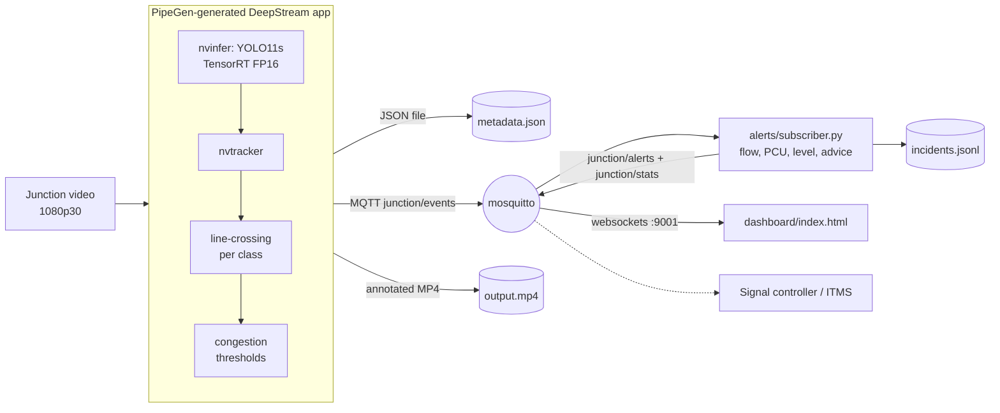
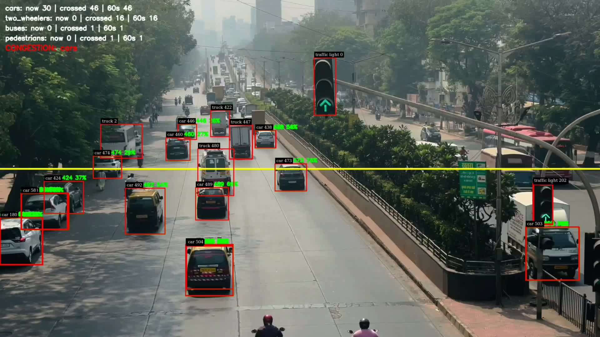
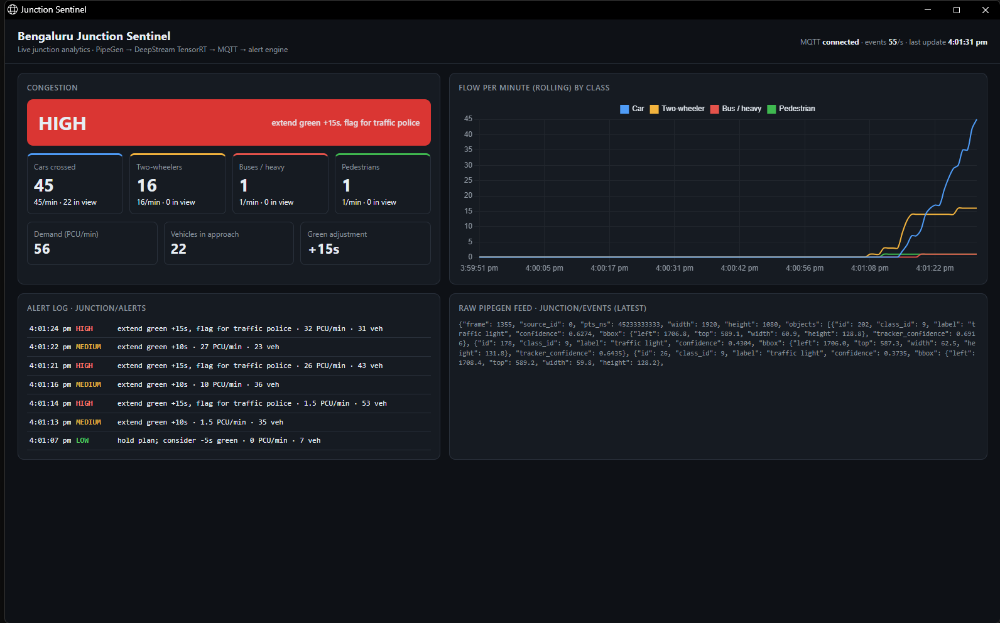

# Bengaluru Junction Sentinel

Live traffic-junction analytics for adaptive signal timing, built with **CraftifAI PipeGen** (Track A).

A PipeGen-generated DeepStream pipeline runs a TensorRT FP16 YOLO11s engine on the junction video. It detects and tracks cars, two-wheelers, buses and pedestrians, counts each class crossing a virtual stop line, and publishes per-frame JSON metadata over MQTT. A small alert engine consumes that feed and turns it into congestion levels and suggested signal actions. A signal controller or a traffic-police dashboard could act on these.

> **PipeGen is load-bearing.** Every detection, track and line-crossing in this repo comes from the PipeGen pipeline in [`pipegen_export/`](pipegen_export/). Nothing here runs a model in Python, OpenCV or Ultralytics. `alerts/` and `dashboard/` only consume PipeGen's MQTT/JSON output.

## Problem

Most Bengaluru junctions run **fixed signal timers**. A green phase lasts just as long at 6 AM as it does in peak traffic. Queues spill back while the cross street sits empty. Two-wheelers dominate the mix, so plain vehicle counts mislead. Signal timing needs **per-class flow**, turned into demand (PCU) and pushed to whatever controls the signal, in real time.

## Track

**Track A — PipeGen.** All 5 stages were driven in PipeGen v0.5.1: Requirement → Pipeline IR → Model → Compiler → Run.

## Pipeline (from PipeGen)

| | |
|---|---|
| **Requirement** (verbatim) | "Detect cars, two-wheelers, buses and pedestrians in a traffic junction video, track them, count each class crossing a virtual stop line, and publish live per-class counts and congestion alerts as JSON metadata and MQTT." |
| **Input** | Video file: `junction_1080p.mp4`, 1920×1080 @ 30 fps, 70.6 s (Pexels #30609021, see *Data*) |
| **Tasks (PIR nodes)** | 1 file input → 2 preprocess (letterbox 640×640, RGB, /255) → 3 **inference: YOLO11s (COCO)** → 4 postprocess (decode, keep car/motorbike/bicycle/bus/truck/person) → 5 tracking (IoU 0.3, max 30 missed frames) → 6 per-class line-crossing (line y = 0.5, both directions, once per track) → 7 congestion alert (60 s rolling window; cars 20, two-wheelers 30, buses 4, pedestrians 10) → 8 JSON / 9 MQTT / 10 annotated MP4 |
| **Model** | PipeGen catalog source **"VehicleDetection"**: YOLO11s ONNX, COCO-80, 9.49 M parameters |
| **Precision** | **TensorRT FP16** engine (`yolo11s.fp16.plan`, 31.1 MB, 256 TRT layers), built by PipeGen's Model stage |
| **Speed (PipeGen benchmark)** | **6.374 ms/frame ≈ 157 fps, 46.8 W** on an RTX 5050 Laptop GPU |
| **Outputs** | `metadata.json` (per-frame tracks and counts) · MQTT `localhost:1883`, topic `junction/events` · annotated `output.mp4` |

Evidence: [`evidence/screens/pir_graph.png`](evidence/screens/pir_graph.png) (Pipeline IR node graph) · [`evidence/screens/trt_speed_report.png`](evidence/screens/trt_speed_report.png) (TensorRT speed, power and thermal report) · [`evidence/pipegen/`](evidence/pipegen/) (raw PipeGen reports: `PipelineIR.json`, `compile.data.json`, `engine.data.json`, `ModelStage.log`).

## Architecture



## Alert engine (consumes PipeGen output only)

`alerts/subscriber.py` subscribes to `junction/events` and does the following:

- Uses PipeGen's track IDs and boxes to keep **cumulative per-class stop-line crossings**. The line matches PIR node 6, at y = 0.5.
- Computes rolling **flow per minute** per class and **PCU demand per minute**. Weights: car 1, two-wheeler 0.5, bus or truck 3.
- Measures **occupancy**, the number of vehicles currently in the approach, as a queue proxy.
- Sets the **congestion level** (LOW / MEDIUM / HIGH) from PCU and occupancy thresholds in `config.yaml`, with a **suggested signal action** for each level (e.g. *extend green +15s*). It also requests a **pedestrian phase** when many pedestrians are waiting.
- Publishes `junction/stats` (1 Hz) and `junction/alerts` (when the level changes, repeated every 15 s while it stays MEDIUM/HIGH), and appends every alert to `alerts/incidents.jsonl`.

`dashboard/index.html` is a single-file dashboard that uses MQTT over websockets. It shows live per-class counters, a flow-over-time chart, a congestion badge, the alert log and the raw PipeGen feed.

## How to run

Requirements: PipeGen v0.5.1 installed per CraftifAI's guide (Docker + NVIDIA Container Toolkit, X11), and mosquitto with a websockets listener on 9001.

```bash
git clone https://github.com/h4ck3rx99-stack/CraftifAIHackathon_CRA004
cd CraftifAIHackathon_CRA004
python3 -m venv .venv && .venv/bin/pip install -r requirements.txt
./scripts/demo.sh          # broker + alert engine + dashboard (http://localhost:8080) + PipeGen run.sh
```

`pipegen_export/` is PipeGen's generated project. `run.sh` executes inside PipeGen's DeepStream container (`craftifaidocker/deepstream:7.1-amd64-v3`).

## Results (real run, RTX 5050 Laptop GPU, WSL2)

| Metric | Value | Source |
|---|---|---|
| TensorRT engine | YOLO11s FP16, 256 layers, 31.1 MB, built in 124.5 s | PipeGen Model stage (`compile.data.json`) |
| Engine latency / throughput | **6.374 ms/frame, ~157 fps** | PipeGen benchmark (`engine.data.json`) |
| GPU power during benchmark | **46.8 W** | PipeGen benchmark |
| End-to-end pipeline (decode → TRT → tracker → analytics → JSON + MQTT + x264 MP4) | 70.6 s of 1080p30 video processed in **41.7 s ≈ 50.8 fps (1.7× real time)** | `run.sh` log: `Execution ended after 0:00:41.68` |
| Frames / objects | **2117 frames, 104,684 tracked objects** | `[meta_json] 2117 frames, 104684 objects` |
| MQTT | **2117 messages** on `junction/events` (one per frame) | `[mqtt] done 2117 frames … 2117 published` |
| Stop-line crossings (PipeGen PIR node 6) | **cars 100 · two-wheelers 40 · buses/heavy 6 · pedestrians 4** | final `fields` in `metadata.json` |
| PipeGen congestion flags (node 7) | cars, two-wheelers, buses over threshold in the last 60 s | `*_congestion` fields |
| Alert engine | **8 alerts**, escalating LOW → MEDIUM → HIGH. Peak: 99 PCU/min, advice "extend green +15s, flag for traffic police" | `evidence/incidents_full_run.jsonl` |

Sample outputs (real, unedited): [`evidence/sample_json.txt`](evidence/sample_json.txt) · [`evidence/sample_mqtt.txt`](evidence/sample_mqtt.txt) · [`evidence/sample_alerts.txt`](evidence/sample_alerts.txt) · [`evidence/pipegen_run_summary.json`](evidence/pipegen_run_summary.json)

Screens: [Pipeline IR](evidence/screens/pir_graph.png) · [TensorRT speed report](evidence/screens/trt_speed_report.png) · [engine compiled](evidence/screens/trt_engine_compiled.png) · [ONNX layer check](evidence/screens/onnx_inspect.png) · [live annotated run](evidence/screens/pipegen_run_frame_t45.jpg) · [dashboard with live alerts](evidence/screens/dashboard_live.png) · [demo video](evidence/demo.mp4)





## Data

Input video: **"Busy urban traffic flow at intersection"** by *aksinfo7 universe* on Pexels (video #30609021), used under the [Pexels License](https://www.pexels.com/license/), which permits free use. It was transcoded from 2560×1440 to 1920×1080 with ffmpeg. The video is not committed to the repo.

## Making PipeGen 0.5.1 work on an RTX 50-series (Blackwell) GPU

PipeGen 0.5.1 ships DeepStream 7.1 (TensorRT 10.3, CUDA 12.6), which predates Blackwell (sm_120). What we hit, and what we did:

1. **TensorRT build failed**: `Error Code 1: Internal Error (Unsupported SM: 0xc00)`. We installed NVIDIA's TensorRT **10.13.3.9 (CUDA 12.9)** runtime packages inside PipeGen's container, then re-ran **PipeGen's own Model Compilation**, which built and benchmarked the FP16 engine. This is reversible: `docker rm -f craftifai-amd64-v3` restores the stock container.
2. **Pipeline appeared to hang before PLAYING.** DeepStream 7.1's NvBufSurfTransform ships only sm_90 PTX. On sm_120, the driver JIT-compiles these kernels at startup, which takes about **60–75 s every run**. After that warm-up the pipeline runs at full speed. We also rebuilt DeepStream's open-source `libnvds_infer` against the TRT 10.13 headers. (We confirmed later that its "layers num: 0" message is cosmetic for static-shape engines.)
3. PipeGen's generated `run.sh` initially left `DIR` / `H264ENC` undefined. We described the fix in PipeGen's chat and **PipeGen recompiled it** (compile = SUCCESS). PipeGen's own post-compile test run then timed out during the JIT warm-up from point 2. Before it could retry, the account's free PipeGen LLM credits ran out ("You've used your free PipeGen credits"). So the live run was done by executing PipeGen's generated `run.sh` directly, inside PipeGen's container, unmodified. That is the deployment artifact PipeGen produces.

## Honest limitations

- PipeGen's GUI still shows the Compiler stage as "error". Its internal test run timed out during the Blackwell JIT warm-up, and with credits exhausted we couldn't trigger a re-test. The generated app itself compiled and ran end to end (logs above).
- The PIR postprocess keeps more COCO classes than requested: traffic lights also appear in `objects`. The alert engine ignores them, and PipeGen's per-class counters only count cars, two-wheelers, buses/trucks and pedestrians.
- YOLO11s is a generic COCO model. Some small or far two-wheelers are missed, and autos and tempos are counted as cars or trucks. An Indian-traffic fine-tune (e.g. on IDD) would help but was out of scope (no custom training).
- One camera approach, recorded video (not RTSP). Thresholds in `config.yaml` are illustrative and not calibrated against a real junction's saturation flow.
- The x264 encoder was used because the generated script found no `/dev/v4l2-nvenc` under WSL2. The MP4 that PipeGen writes is fragmented with Annex-B NALs. We remuxed a viewable copy for the demo video with GStreamer (`qtdemux ! h264parse ! mp4mux`).

## Bonus: Edge Optimization (INT8)

Not completed. PipeGen offers **Quantize to INT8** (calibrated on sample frames) from the same Model-stage card. We ran out of time, and our PipeGen LLM credits, before running it. The FP16 numbers above are our measured baseline: 6.374 ms, ~157 fps, 46.8 W.

